<div align="center">

# 🛡️ Master DevSecOps Infrastructure Pipeline
### Enterprise 4-Stage Shift-Left Security, FinOps Cost Gating & Terraform CI/CD

[](https://dev.azure.com)
[](#-stage-2--multi-engine-security-suite)
[](#-stage-2--multi-engine-security-suite)
[](#-predictive-finops-cost-engine)

**Architected by [Mihir Maurya](https://github.com/MihirMaurya-dev) · Enterprise Cloud Architect & DevSecOps**

</div>

---

## 🚀 Architectural Overview

This repository contains a **production-hardened DevSecOps CI/CD pipeline** designed for Azure DevOps and GitHub Actions. It enforces strict supply chain integrity, automated FinOps cost forecasting, multi-engine security scanning, and human-in-the-loop governance before applying any Terraform code.

```mermaid
flowchart LR
    subgraph S1["📋 Stage 1: Plan & FinOps"]
        A[Git Push / PR] --> B[Terraform Init & Validate]
        B --> C[TFLint Rule Enforcement]
        C --> D[Compile Plan: tfplan]
        D --> E[Azure Retail Prices API\nCost Forecast]
        E --> F[Publish Plan Artifact]
    end

    subgraph S2["🔐 Stage 2: DevSecOps Gates"]
        G[Gitleaks Secret Scan]
        H[TruffleHog Verified Detect]
        I[tfsec CIS Benchmark]
        J[Trivy Critical/High Scan]
    end

    subgraph S3["🚦 Stage 3: Human Gate"]
        K[ADO Environment Gate\nproduction-approval]
    end

    subgraph S4["⚡ Stage 4: Apply"]
        L[Retrieve Verified tfplan] --> M[Terraform Apply\nImmutable Execution]
    end

    F --> S2
    S2 --> K
    K --> S4

    classDef stage1 fill:#08182b,stroke:#00e5ff,stroke-width:2px,color:#fff;
    classDef stage2 fill:#1d0738,stroke:#9d4edd,stroke-width:2px,color:#fff;
    classDef stage3 fill:#2d1900,stroke:#f59e0b,stroke-width:2px,color:#fff;
    classDef stage4 fill:#032111,stroke:#00ff66,stroke-width:2px,color:#fff;

    class S1,A,B,C,D,E,F stage1;
    class S2,G,H,I,J stage2;
    class S3,K stage3;
    class S4,L,M stage4;
```



---

## 🔄 4-Stage Lifecycle Deep Dive

| Stage | Lifecycle Role | Key Tools & Tasks | Verification Output |
|:---:|:---|:---|:---|
| **01** | **Plan & FinOps** | Terraform `init`, `fmt -check`, `validate`, `tflint`, compiled `plan` | `tfplan` artifact + Azure Pricing estimates |
| **02** | **Security Scanning** | **Gitleaks** (Regex secret scanning), **TruffleHog** (Verified token check), **tfsec** (IaC CIS tests), **Trivy** (Container & IaC CVEs) | Published JUnit XML test results into ADO |
| **03** | **Manual Approval** | ADO Environment Check: `production-approval` | Human reviewer signoff gate |
| **04** | **Terraform Apply** | Downloads verified plan artifact, executes `apply` without re-evaluating code | Zero configuration drift execution |

---

## 💰 Predictive FinOps Cost Engine

Integrated directly into **Stage 1**, the pipeline extracts all resource changes from `terraform show -json tfplan` and queries the **Azure Retail Prices API** in real-time. 

Before any code is approved, engineers and reviewers see immediate pricing telemetry for:
- Virtual Machines (`azurerm_virtual_machine`)
- Storage Accounts (`azurerm_storage_account`)
- Managed Databases (`azurerm_sql_database`)
- Kubernetes Clusters (`azurerm_kubernetes_cluster`)

```text
🔍 azurerm_kubernetes_cluster → querying: Azure Kubernetes Service
  SKU: Standard | Region: eastus | $0.1000/1 Hour
🔍 azurerm_storage_account → querying: Storage
  SKU: Standard LRS | Region: eastus | $0.0180/1 GB/Month
```

---

## 🔐 Multi-Engine Security Suite

1. **Gitleaks (`.gitleaks.toml`)**:
   - High-speed regex secret detection scanning for leaked API keys, tokens, and private credentials.
2. **TruffleHog**:
   - Scans commits for verified live secrets across the Git commit tree.
3. **tfsec**:
   - Static analysis enforcing CIS Microsoft Azure Foundations Benchmark rules.
4. **Trivy**:
   - Comprehensive vulnerability scanner catching misconfigurations before provisioning.

All findings are published as **JUnit XML test suites** directly into the Azure DevOps Test tab for immediate audit logging.

---

## ⚙️ Environment Setup

### 1. Azure Storage Backend for State Locking
```bash
az group create --name rg-terraform-state --location eastus
az storage account create --name sttfstatedev001 --resource-group rg-terraform-state --sku Standard_LRS
az storage container create --name tfstate --account-name sttfstatedev001
```

### 2. Configure ADO Environment Approval Gate
1. Navigate to **Pipelines** ➔ **Environments** ➔ **New environment**.
2. Name: `production-approval`.
3. In **Approvals and checks**, enable **Approvals** and assign required architectural reviewers.

---

<div align="center">

**[Explore Portfolio](https://b18g119.online)** · **[Connect on LinkedIn](https://linkedin.com/in/mihirmauryaa)** · **[DevOps Knowledge Vault](https://github.com/MihirMaurya-dev/DevOps-Notes)**

</div>
